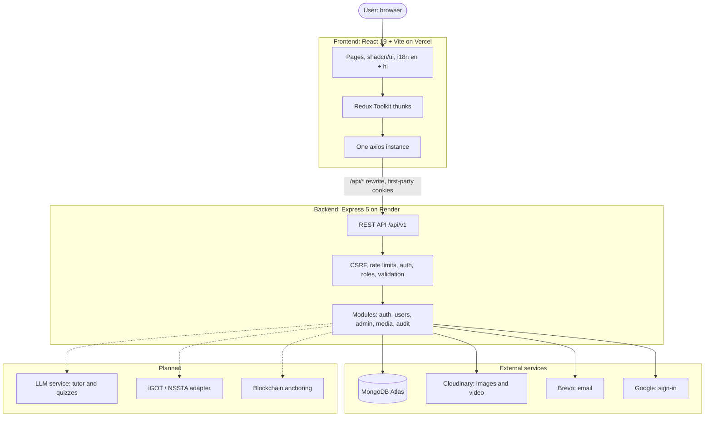

<div align="center">

# SAMARTH AI

**Smart Competency Intelligence for Official Statistics**

Measure the skills. Find the gaps. Build the path. Prove the progress.

-D97757?style=for-the-badge)


[Quick start](#getting-started) · [What is built](#what-is-built-today) · [Roles](#roles-and-how-accounts-are-created) · [Rules for contributors](#working-on-this-repo) · [Roadmap](#roadmap)

</div>

> **Prototype notice.** SAMARTH AI is a student prototype for Smart India Hackathon problem statement **SIH26101** (Ministry of Statistics and Programme Implementation). It is **not** an official Government of India website and does not imply endorsement by MoSPI, NSSTA or iGOT Karmayogi.

---

## The problem

India's official statistics depend on people: officers who design surveys, clean data, apply standards and publish numbers the country plans with. Their skills are rarely measured in a consistent way. Training is offered in bulk, so a senior officer and a new joiner often get the same course, and nobody can say which skills actually improved.

The result is a gap that is invisible until a report is late, a method is applied wrongly or a standard is missed.

**SAMARTH AI makes the gap visible, and then closes it.** It builds a competency profile for every official, compares it with what their role needs, recommends the right learning in the right order, and keeps a tamper-evident record of the evidence.

## What SAMARTH stands for

| Letter | Meaning |
|---|---|
| **S** | **S**kill assessment |
| **A** | **A**daptive learning |
| **M** | **M**apping competencies |
| **A** | **A**I-driven analytics |
| **R** | **R**ecommendations |
| **T** | **T**raining pathways |
| **H** | **H**olistic capacity building |

---

## What is built today

This repository holds **milestone 1**: the foundation every later feature stands on. We list what exists and what does not, so nobody has to guess.

| Area | Status | What it includes |
|---|---|---|
| Marketing site | Built | Landing page with an animated laptop hero and scroll-driven story sections, About page with the build story, Privacy, Terms, and 15 state pages (not found, offline, maintenance, session expired and more) |
| Accounts | Built | Sign up, email verification, sign in, Google sign-in, forgot and reset password, account lockout, sessions and devices, email change with undo, account deletion with a grace period |
| Four roles | Built | Learner, trainer, admin and platform admin, with invitations and a user management area |
| Admin area | Built | Team invitations (send, resend, revoke) and a users page (search, filter, suspend, change role) |
| Security | Built | HttpOnly cookie auth with CSRF protection, refresh-token rotation with reuse detection, rate limits, strict CORS, hash-chained audit log |
| Media | Built | Signed Cloudinary uploads and webhook verification, avatars |
| Languages and themes | Built | English and Hindi, light and dark themes |
| Quality | Built | Automated unit, integration and component tests, plus a Postman collection that covers every API route |
| Competency profile, gap analysis, learning paths | Planned | See the [roadmap](#roadmap) |
| AI tutor and quiz generation | Planned | |
| iGOT / NSSTA recommendations | Planned | Will start with a mock adapter |
| Blockchain anchoring of the audit trail | Planned | |

## Product tour

The hero shows a laptop opening onto a demo **My competency** page and walks through the product in four steps:

1. **Profile estimated.** From designation, role, experience and past training, the system estimates a starting level (0 to 5) for each competency.
2. **Gaps found.** Each level is compared with what the role requires. The difference is the gap, ranked by priority.
3. **Path recommended.** The biggest gaps become an ordered learning path from iGOT Karmayogi and NSSTA programmes (simulated in this prototype).
4. **Evidence updates the level.** A quiz result or completed course moves the level, and the change is recorded.

Everything shown in the demo is sample data and is labelled as such in the interface.

---

## Roles and how accounts are created

| Role | Who they are | How the account is created |
|---|---|---|
| **Learner** | An official who wants to build skills | Registers themself, or signs in with Google. The role is always `learner`; a role field in a request is rejected |
| **Trainer** | A person who runs or reviews learning | Invited by an admin or a platform admin |
| **Admin** | Manages people for the organisation | Invited by a **platform admin only** |
| **Platform admin** | Owns the platform | Listed in the server environment variable `PLATFORM_ADMINS` (stored internally as `superadmin`) |

`PLATFORM_ADMINS` takes up to 10 comma-separated entries, each an `email` or an `email:password`. On every server start, in production too, the backend creates any missing platform admin, promotes an existing verified account with that email, and never demotes anyone. An entry without a password receives a one-time set-password email. An entry with a password is temporary and must be changed at first sign-in. A password equal to or containing the email address is refused on purpose.

---

## Architecture



Vercel serves the static app and rewrites `/api/*` to the Render API, so the browser sees one site and the authentication cookies stay first-party.

## Security by design

| Layer | What is implemented |
|---|---|
| **Tokens never touch JavaScript** | Access and refresh tokens live only in HttpOnly cookies. Nothing is kept in `localStorage`, `sessionStorage`, Redux or URLs |
| **CSRF protection** | A readable double-submit cookie is sent back in the `X-CSRF-Token` header on every unsafe request |
| **Refresh rotation** | Refresh tokens are single use. Replaying an old one revokes the whole session family |
| **No account enumeration** | Wrong password, unknown email and Google-only accounts all return the same answer with the same timing. Forgot-password always answers neutrally |
| **Lockout** | Five failed attempts lock the account for 15 minutes, doubling on repeats, tracked by an HMAC of the email so fake accounts look the same |
| **Role checks on every route** | Each protected route lists its roles explicitly. Foreign resources return 404, not 403 |
| **Invitations, not self-promotion** | Elevated roles cannot be requested. They come only from invitations or the server environment |
| **Rate limiting** | Per IP, per email and per user, with `Retry-After` on every 429 |
| **Strict CORS and headers** | Exact origins only, never a wildcard. `helmet` headers, frame denial |
| **Audit trail** | Important actions are written to a hash-chained audit log, so tampering is detectable |
| **Secrets** | Placeholders only in `.env.sample`. Config is validated at start and a bad value stops the process with a clear message |

---

## Tech stack

| Layer | Choices |
|---|---|
| **Frontend** | React 19, Vite, Tailwind CSS v4 (CSS-first), shadcn/ui, Redux Toolkit with `createAsyncThunk`, axios, React Router, react-hook-form with Zod, react-i18next, Motion and Lenis for marketing animation, filled react-icons |
| **Backend** | Node.js 24, Express 5, Mongoose 9, Zod, helmet, pino, bcryptjs, jsonwebtoken, google-auth-library |
| **Database** | MongoDB Atlas, with aggregation pipelines planned for analytics |
| **Media and email** | Cloudinary, Brevo (a log transport is used in development) |
| **Testing** | Vitest, Supertest, mongodb-memory-server, MSW, vitest-axe, Postman with newman |
| **Typography** | Fraunces for headlines, Instrument Sans for interface text, JetBrains Mono for numbers, Noto Sans Devanagari for Hindi |

Everything is plain JavaScript (ES modules). There is no TypeScript.

---

## Getting started

### Prerequisites

- Node.js 22 or newer (24 recommended)
- A MongoDB database: a free [Atlas](https://www.mongodb.com/atlas) M0 cluster is enough
- Optional for full features: a Google OAuth client ID, a Cloudinary account, a Brevo account

### 1. Install

```bash
git clone <repository-url>
cd SAMARTH-AI
npm run install:all
```

### 2. Configure the backend

Copy `backend/.env.sample` to `backend/.env` and fill it in. The file explains each value. The four you must set to start the server are:

| Variable | What it is |
|---|---|
| `MONGODB_URI` | Your MongoDB connection string |
| `ACCESS_TOKEN_SECRET` | A random string of at least 32 characters |
| `REFRESH_TOKEN_SECRET` | A different random string |
| `IDENTIFIER_HASH_SECRET` | A third, different random string |

Generate each secret with:

```bash
node -e "console.log(require('crypto').randomBytes(48).toString('hex'))"
```

To get a platform admin account, also set `PLATFORM_ADMINS` (see [Roles](#roles-and-how-accounts-are-created)). In development, emails are printed in the backend terminal marked `DEV ONLY`, so you do not need an email provider.

### 3. Configure the frontend

Copy `frontend/.env.sample` to `frontend/.env`. The defaults work for local development. To enable Google sign-in, put the same client ID in `GOOGLE_CLIENT_ID` (backend) and `VITE_GOOGLE_CLIENT_ID` (frontend), add `http://localhost` and `http://localhost:5173` as authorised JavaScript origins in Google Cloud, and add yourself as a test user while the consent screen is in testing mode. No redirect URI is needed.

### 4. Run

```bash
npm run dev
```

The app is at <http://localhost:5173> and the API at <http://localhost:8000>. `GET /health` answers when the process is alive and `GET /ready` when the database responds.

> **Never commit `.env` files.** If a secret is ever committed, treat it as leaked and rotate it.

---

## Commands

Run these from the repository root.

| Command | What it does |
|---|---|
| `npm run dev` | Starts the API and the web app together |
| `npm run lint` | ESLint for backend and frontend |
| `npm test` | Backend then frontend unit and integration tests |
| `npm run test:api` | Starts the API with an in-memory database and runs the whole Postman collection with newman. Needs no network and no secrets |
| `npm run build` | Production build of the frontend, with a bundle size budget |
| `npm run rules:check` | Runs the project's automated rule checks (about 108 checks) |

Run backend and frontend tests from their own folders or through the root scripts above. Do not run `vitest` from the repository root.

## Repository layout

```
SAMARTH-AI/
├── backend/     Express API: src/modules (auth, users, admin, media, audit), config, middlewares,
│                integrations (email, cloudinary, google), postman/, openapi.yaml
├── frontend/    React app: src/features (auth, admin, marketing, dashboard, ...), components, lib, i18n
├── scripts/     Rule checker, agent hooks, dev launcher
└── CLAUDE.md    Entry point for AI coding agents
```

The rulebooks and design documents live in a sibling `docs/` folder that is **not** part of this repository. Ask a maintainer for it: `<link to the shared docs>`.

---

## Working on this repo

Several people (and AI assistants) work on this project, so a few rules keep us from stepping on each other.

1. **Never push to `main`.** Create a branch for each task, for example `feature/<your-name>-<what>`.
2. **Open a pull request** into `main` and describe what changed and why. A maintainer reviews and merges.
3. **Keep pull requests small** and about one thing.
4. **Pull the latest `main`** before you start a task.
5. **Say what you are taking** in the team chat before you begin, so two people do not build the same thing.
6. **Read the rulebook first.** Start at `docs/rules/00-index.md`. The charter `docs/rules/DECISIONS.md` wins any conflict.
7. **Tests ship with the code**: backend first, then frontend, and a Postman request for every new endpoint.
8. **Before you open a PR**, run `npm run rules:check`, `npm run lint`, the tests and `npm run build`, and fix what they report.
9. **Never commit secrets** or `.env` files.

**AI assistants.** If you use Claude Code, it reads `CLAUDE.md` and the rulebooks automatically, and hooks check file locations, forbidden commands and rule violations as it works. The hooks also block `git commit` and `git push`, because people commit. Please keep using them.

### Design rules in one minute

- Colours come only from tokens in `frontend/src/index.css` (light and dark, primary `#D97757`). No gradients, glow or one-off colours.
- UI is built from shadcn components. Icons come only from the registry in `@/components/icons`.
- Every visible string is a translation key in English and Hindi.
- Animation is limited to `transform` and `opacity`, respects reduced motion, and appears only on marketing and sign-in pages.
- Every data view handles loading, empty, error and success states.

---

## Roadmap

- [ ] **Competency framework and profile**: levels 0 to 5 for statistics competencies, estimated at onboarding
- [ ] **Gap analysis**: required level minus current level, ranked by priority
- [ ] **Learning paths**: ordered recommendations from iGOT Karmayogi and NSSTA programmes (mock adapter first)
- [ ] **Quiz and content engine**: questions generated from uploaded material, with feedback
- [ ] **AI tutor** that answers with citations to the source material
- [ ] **Dashboards** for learners, trainers and admins
- [ ] **Audit anchoring** on a blockchain for tamper-evident certificates
- [ ] **Notifications** and real-time updates
- [ ] **Account export and deletion jobs**
- [ ] **CI pipeline and deployment** (Vercel and Render)

## Team

Built by a team of six for Smart India Hackathon. The names, roles and links are listed on the **About** page of the app. Replace the placeholders in `frontend/src/features/marketing/data/developers.js` with the real team.

## License

No license has been chosen yet. Until one is added, all rights are reserved by the authors.

---

<div align="center">

**SAMARTH AI: because you cannot close a gap you cannot see.**

</div>
